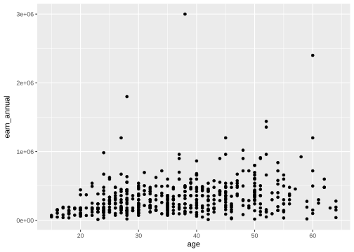
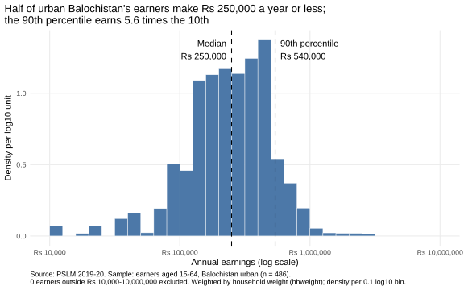
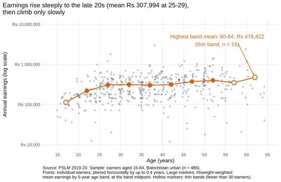
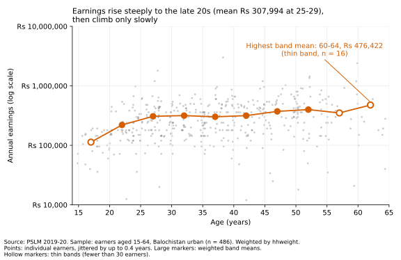

# ECO346 Assignment 1: earnings in urban Balochistan (PSLM 2019-20)

**Name / Reg. no.:** FA24-BEDS-079 (roll no. 79) &nbsp; **Section:** A
**Variant:** 79 = 9 x 8 + 7, so variant **7: Balochistan (prov_code 4), urban (urban_rural 2)**.

## Repository layout

```
.
├── data/        pslm_person_subset.csv, pslm_hh_subset.csv   (input data)
├── scripts/     00_helpers.R, 01_default.R, 02_distribution.R,
│                03_relationship.R, 04_second_language.py
├── figures/     default.svg, distribution.svg, relationship.svg, relationship_python.svg
├── tables/      band_table_R.csv   (written by 03, read by 04)
├── FA24-BEDS-079.pptx             (presentation)
├── run_all.sh
└── requirements.txt
```

## How to reproduce

Run from the repository root, in this order (no internet needed; R packages: readr, dplyr, ggplot2, scales, svglite; Python: pandas, numpy, matplotlib; see `requirements.txt`):

```
Rscript scripts/01_default.R
Rscript scripts/02_distribution.R
Rscript scripts/03_relationship.R
python scripts/04_second_language.py     # must run AFTER 03: it compares against tables/band_table_R.csv
```

or simply `bash run_all.sh`. The scripts create `figures/` and `tables/` if they are missing.

## Figures





## Question 2: the distribution
486 earners; weighted median Rs 250,000; unweighted median Rs 264,000; weighted 10th percentile Rs 96,000; weighted 90th percentile Rs 540,000; ratio 5.62; 0 earners excluded.

Urban Balochistan earnings cluster between roughly Rs 100,000 and Rs 600,000, with a thin left tail and almost nothing above Rs 1 million. The weighted median (Rs 250,000) is below the unweighted one (Rs 264,000) because earners in high-weight households, who stand for more households, earn less: median Rs 240,000 against Rs 300,000 in the rest. Ignoring weights therefore overstates the typical earner.

## Question 3: the relationship
| Band | Earners | Weighted mean earnings (Rs) |
|---|---:|---:|
| 15-19 (thin) | 22 | 113,382 |
| 20-24 | 56 | 220,435 |
| 25-29 | 69 | 307,994 |
| 30-34 | 62 | 316,659 |
| 35-39 | 80 | 302,071 |
| 40-44 | 60 | 316,147 |
| 45-49 | 47 | 372,723 |
| 50-54 | 55 | 399,250 |
| 55-59 (thin) | 19 | 350,772 |
| 60-64 (thin) | 16 | 476,422 |

Band 25-29: Rs 307,994. Band 45-49: Rs 372,723. Highest weighted mean: 60-64 (Rs 476,422, thin band).

Earnings rise steeply from the teens to the late 20s (Rs 113,382 at 15-19; Rs 307,994 at 25-29), stay near Rs 300,000-320,000 through the early 40s, then rise modestly to Rs 372,723 at 45-49. The highest band mean, 60-64, rests on only 16 earners, so it is noise-prone. Spread within every age is wide: ages overlap heavily. The figure cannot tell us whether an individual's earnings grow with experience, because it is a cross-section and mixes age with cohort differences.

## Question 4: the makeover
First, a log scale: earnings span two orders of magnitude, and the default's linear axis crushes most points at the bottom while one Rs 3 million earner sets the scale; logs show proportional differences. Second, transparency and jitter against overplotting: ages are whole numbers, so default points stack in columns. Third, weighted band means joined by a line: conditional means show the pattern the cloud hides, with hollow markers for thin bands. I also labelled axes in rupees, removed the grey panel (data-ink), and wrote a finding as title. What the default shows that the redesign hides: absolute rupee distances; on a log axis the top earners look close to the rest.

## Question 5: a second language (Python)
25-29 band mean: R = Rs 307,994; Python = Rs 307,994.

Point size differed: ggplot's default point is small, while matplotlib's scatter default (s=36) is much larger and hides the pattern. I set s=8 and alpha=0.3, matched marker styles, fixed the log axis limits and ticks to Rs 10,000-10,000,000, and used a fixed jitter seed. Band tables matched to the rupee because I computed the weighted mean directly (sum of w*x over sum of w) in both languages.
